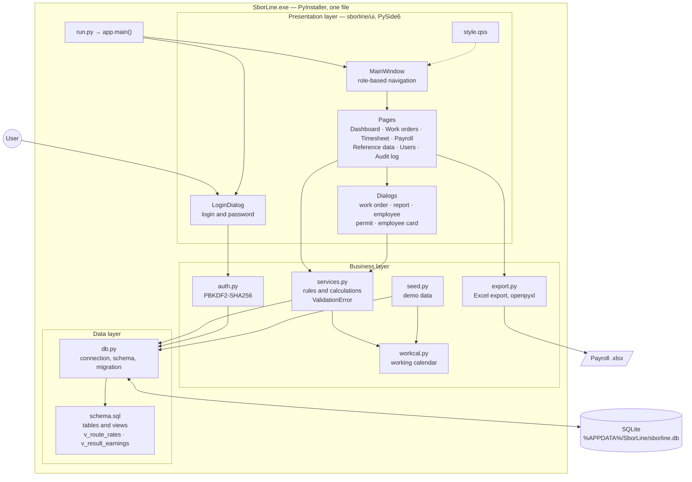
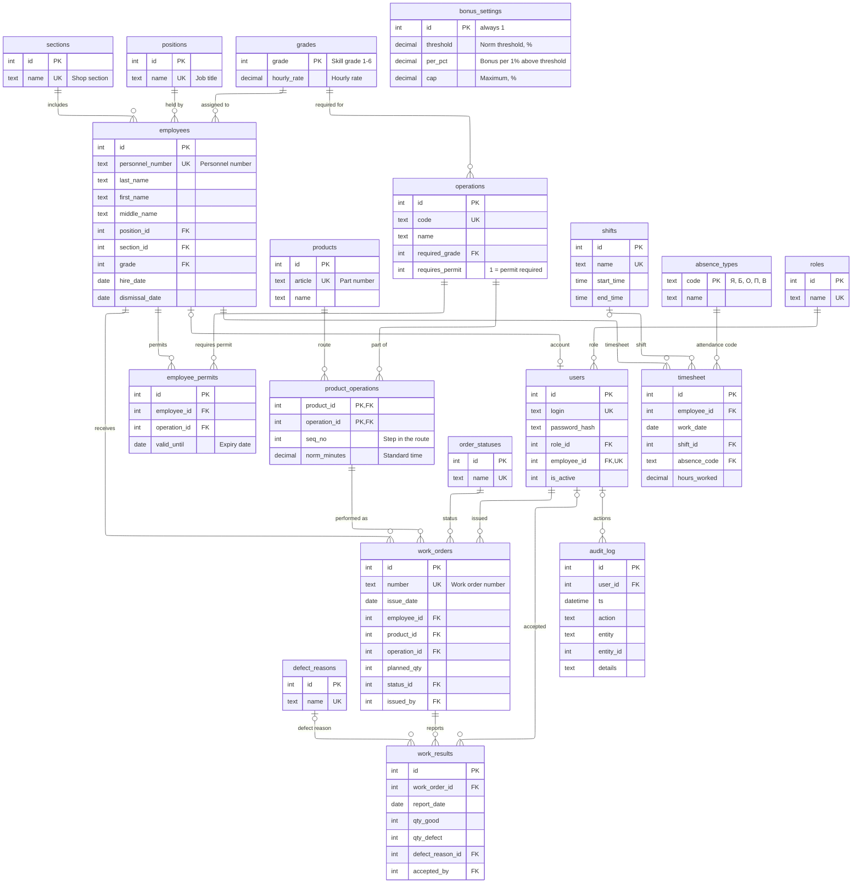
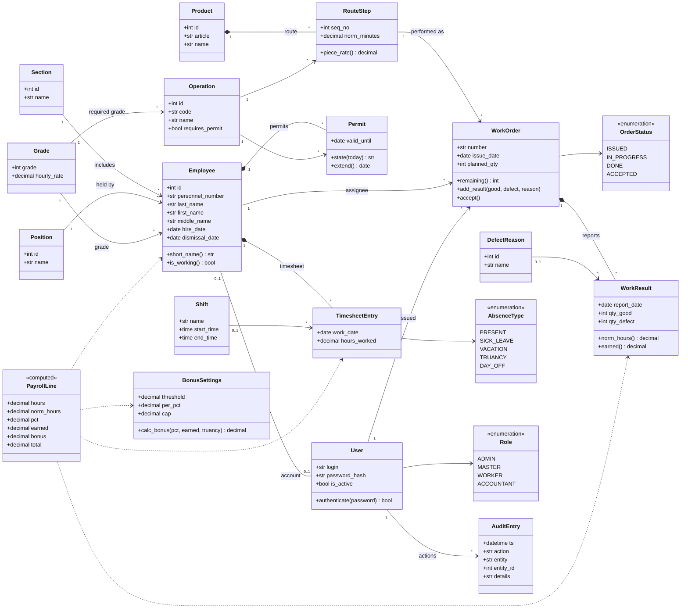
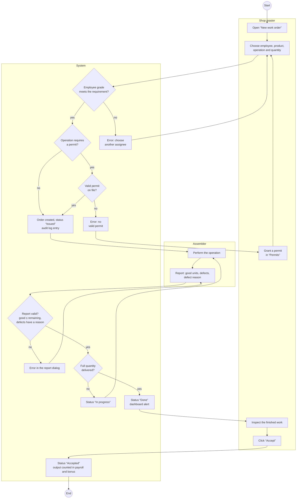
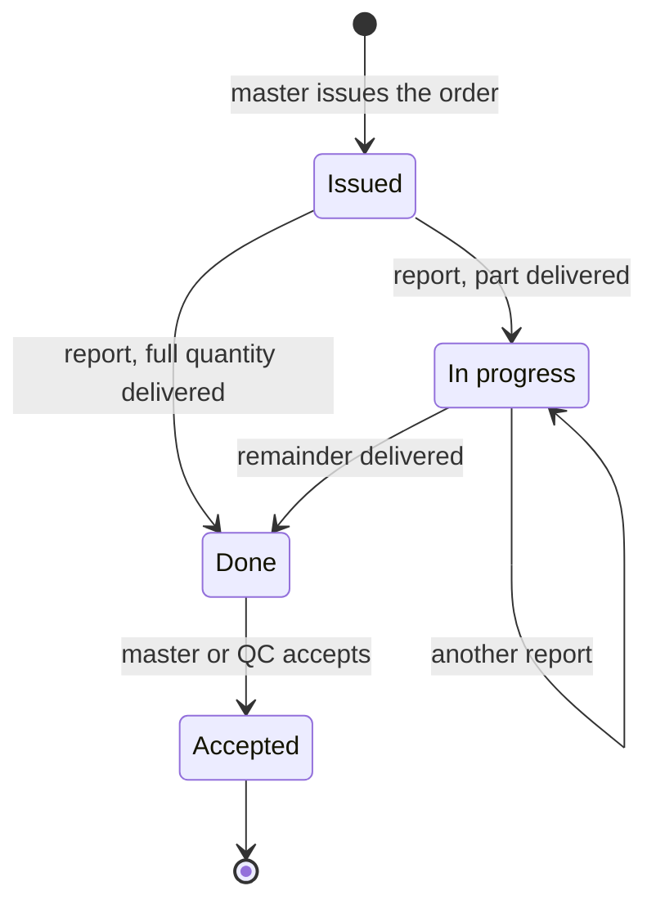
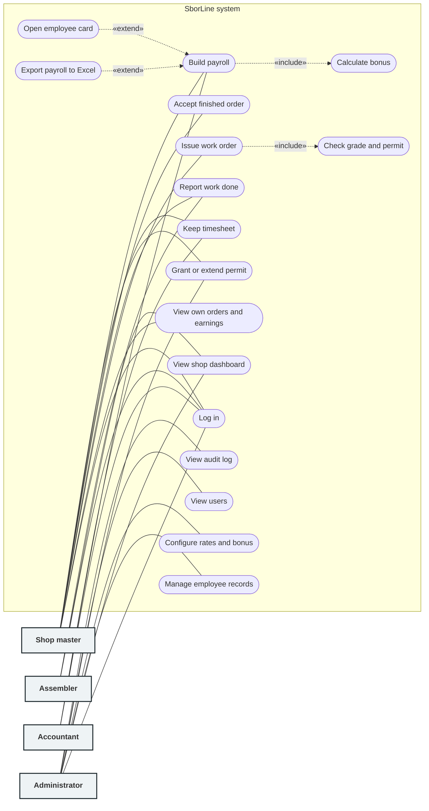

# SborLine — System Diagrams

Automated information system for tracking the work of assembly shop employees. The diagrams are written in Mermaid and render directly on GitHub.

Русская версия: [diagrams.ru.md](diagrams.ru.md)

1. [System Architecture](#1-system-architecture)
2. [ER Diagram](#2-er-diagram)
3. [Class Diagram (Domain Model)](#3-class-diagram-domain-model)
4. [Activity Diagram (Work Order Lifecycle)](#4-activity-diagram-work-order-lifecycle)
5. [Use Case Diagram](#5-use-case-diagram)

## 1. System Architecture

A three-layer desktop application packaged by PyInstaller into a single `SborLine.exe`. The UI reaches the data only through the business layer, which enforces the rules (grade, permit, remaining quantity) and writes the audit log.

## 2. ER Diagram

The schema is in third normal form. Derived values (piece rate, earnings, norm fulfilment) are not stored: the `v_route_rates` and `v_result_earnings` views compute them.

Attendance codes follow the Russian timesheet convention: Я — present, Б — sick leave, О — vacation, П — truancy, В — day off.

## 3. Class Diagram (Domain Model)

Domain concepts and the rules attached to them. A payroll line is not stored: it is assembled for each pay period from the timesheet, work reports and bonus settings.

## 4. Activity Diagram (Work Order Lifecycle)

The work order is the system's core document, from issue until its output reaches the payroll. Swimlanes show who performs each step.

The same transitions as a work order state diagram:

## 5. Use Case Diagram

Four roles and the functions available to each. Every role has to log in. «include» links are mandatory (issuing an order always checks grade and permit); «extend» links are optional.

