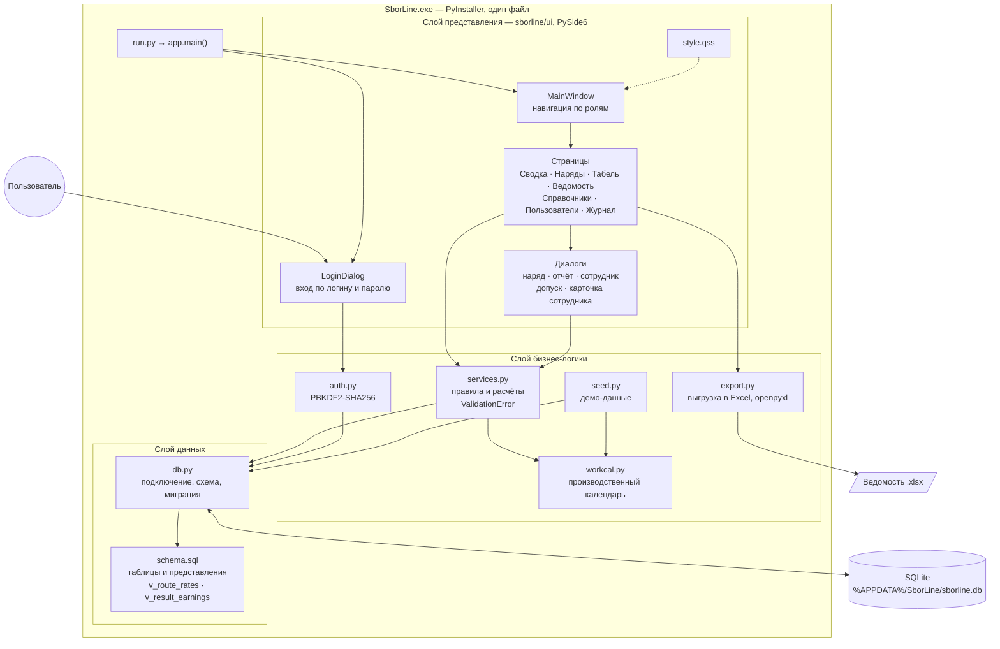
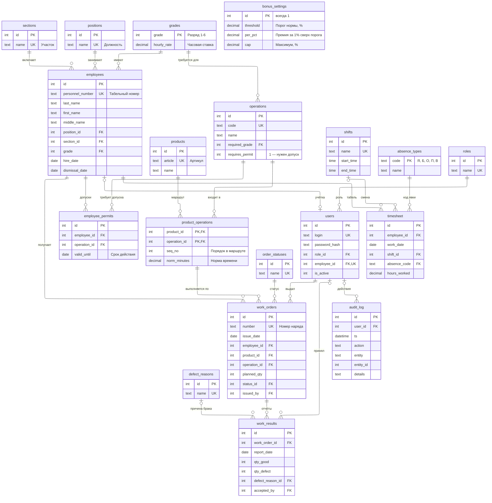
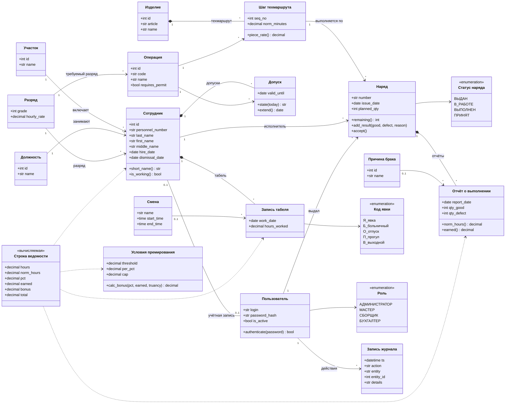
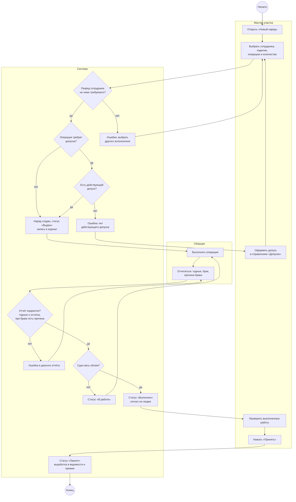
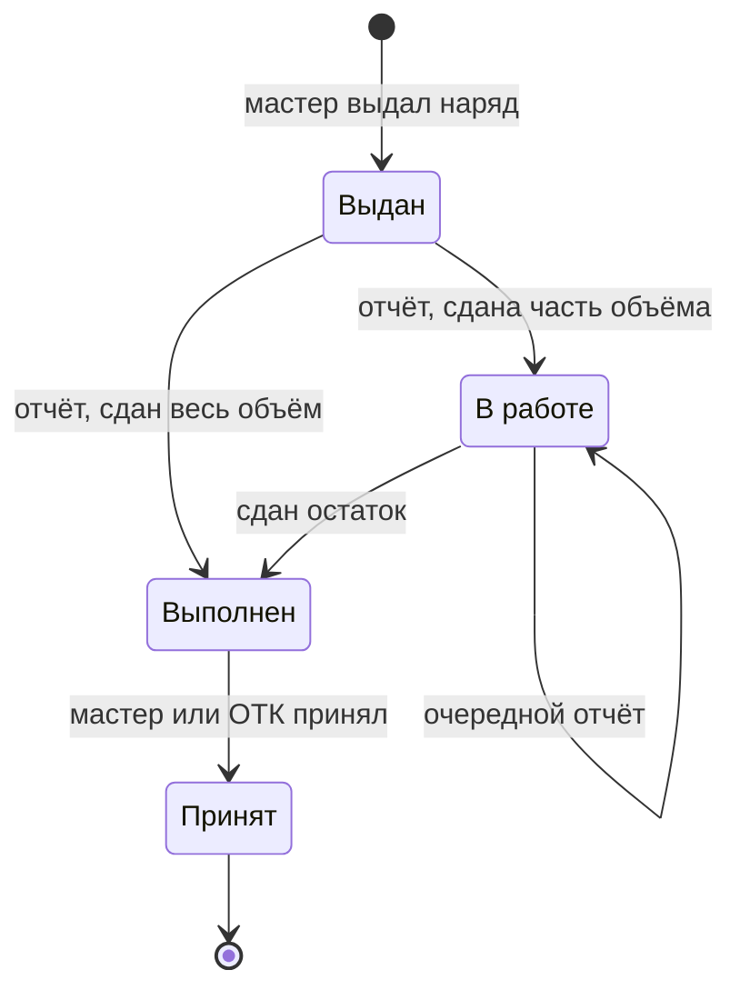
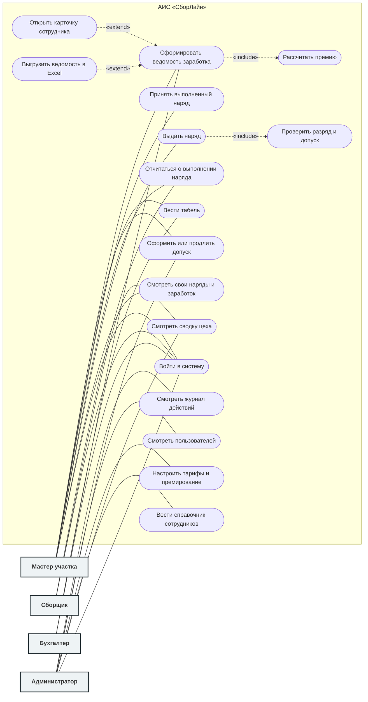

# СборЛайн — диаграммы системы

АИС учёта работы сотрудников сборочного цеха предприятия по производству мебельной фурнитуры: петель, шариковых направляющих и газлифтов. Диаграммы написаны на Mermaid и отрисовываются прямо на GitHub.

English version: [diagrams.en.md](diagrams.en.md)

1. [Архитектура системы](#1-архитектура-системы)
2. [ER-диаграмма](#2-er-диаграмма)
3. [Диаграмма классов (доменная модель)](#3-диаграмма-классов-доменная-модель)
4. [Диаграмма деятельности (жизненный цикл наряда)](#4-диаграмма-деятельности-жизненный-цикл-наряда)
5. [Диаграмма прецедентов (карта прецедентов)](#5-диаграмма-прецедентов-карта-прецедентов)

## 1. Архитектура системы

Настольное приложение из трёх слоёв, собранное PyInstaller в один `SborLine.exe`. Интерфейс обращается к данным только через слой бизнес-логики: там проверяются правила (разряд, допуск, остаток по наряду) и пишется журнал действий.

## 2. ER-диаграмма

Схема в третьей нормальной форме. Производные величины (расценка, заработок, процент выполнения нормы) не хранятся, а считаются в представлениях `v_route_rates` и `v_result_earnings`.

## 3. Диаграмма классов (доменная модель)

Понятия предметной области и правила, которые за ними закреплены. «Строка ведомости» не хранится: она собирается из табеля, отчётов и условий премирования на каждый расчётный период.

## 4. Диаграмма деятельности (жизненный цикл наряда)

Наряд — основной документ системы: от выдачи до попадания выработки в ведомость. Полосы показывают, кто выполняет каждый шаг.

Те же переходы в виде диаграммы состояний наряда:

## 5. Диаграмма прецедентов (карта прецедентов)

Четыре роли и доступные им функции. Вход в систему нужен всем ролям. Связи «include» обязательны (выдача наряда всегда проверяет разряд и допуск), связи «extend» необязательны.

